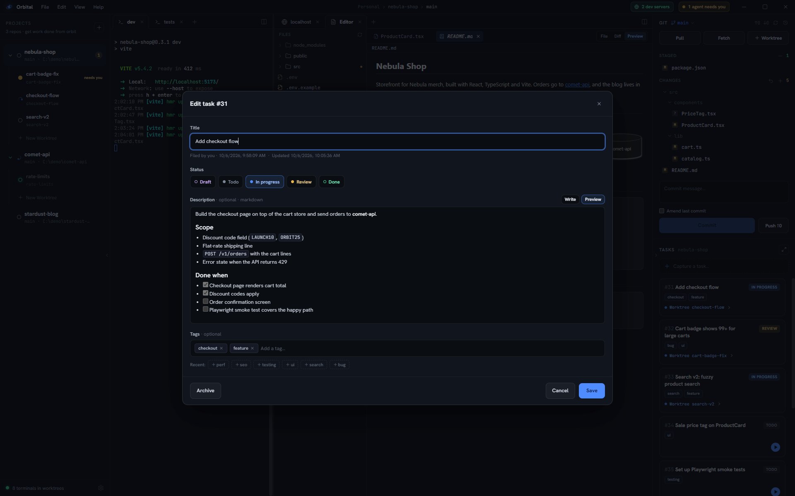
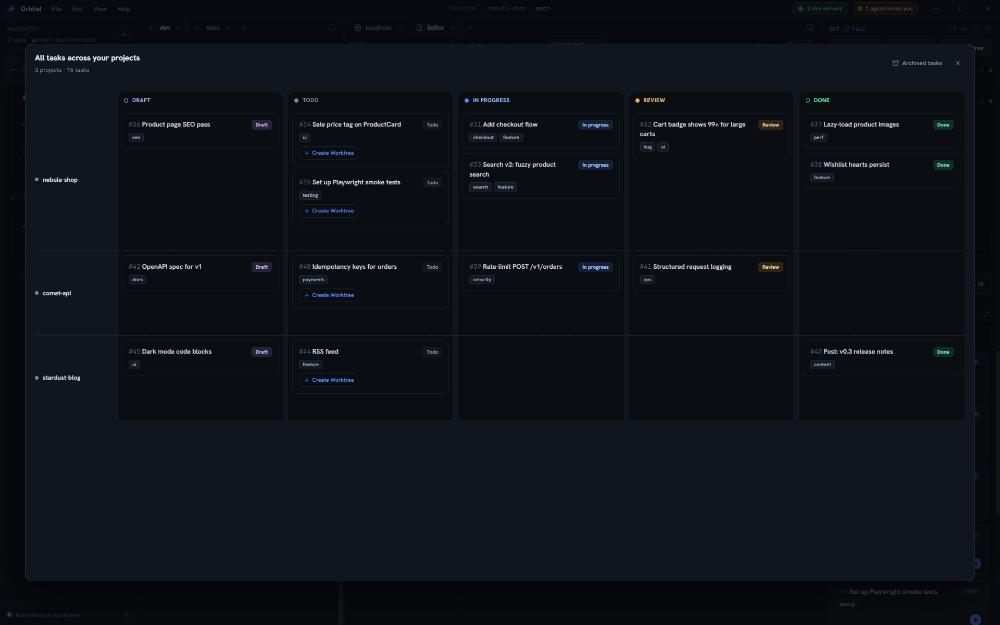

Each project has a lightweight task tracker in the right panel, built for
capture speed rather than ceremony.

## Capturing

Type into **Capture a task…** and press Enter. The task lands in the active
project as `todo` with the next task number. Numbers are unique across all
your projects, so `#42` always means one task.

In a project with several repos, a task is also filed under one of them, or
under none when the work spans the project. The capture box says where it
goes:

- **Capture a task for api…** in one of the repo's sessions: filed under that
  repo. The panel lists that repo's tasks first, then a collapsed **Rest of
  project** section with everything else.
- **Capture a project task…** in the project session (the home repo's root
  checkout, or the project's folder): filed under no repo. The panel lists
  every task in the project, each with a chip naming its repo.

A project with one repo has no repo picking at all: every task is simply in it.
Click a task's repo chip (or right-click the card and pick **Repo**) to file it
somewhere else.

Each card shows its number and title, a status chip, tags, a link to its
worktree when it has one, and a small mark when an agent filed it rather than
you.

## Editing

Click a task's title to open it in the **Edit Task** dialog:

- the title
- a **status**: `draft → todo → in progress → ready for review → done`
- a **Markdown description** with a write/preview toggle
- **tags**, with suggestions from the tags you've already used (Enter or comma
  adds one, Backspace removes the last)
- who filed it (you or an agent) and when it was created and last updated



Right-click a card for **Edit task**, **Start Worktree** (or **Go to Worktree**
once it has one), **Repo** and **Archive task**. The dialog has a **Repo** field
too, in projects with more than one repo. A task with a worktree follows that
worktree's repo: its repo can't change until the worktree is removed.

Tasks are archived, never deleted: an archived task leaves the board and the
task list but keeps its number, and its tags still show up as suggestions.
The **Archived tasks** link at the top of the full board lists the active
project's, each with an **Unarchive** button.

`draft` is for half-formed ideas you don't want to read as ready work.

## The full board

The expand button at the top of the task list opens the **full board** for
the active project. With more than one repo it has a lane per repo across the
status columns: first **Project** for tasks filed under no repo, then the home
repo, then the other repos. Drag cards between columns to change status, and
between lanes to file a task under another repo (into **Project** to clear its
repo). A card with a worktree stays in its lane. A project with one repo gets
one lane. Hover an empty spot in a column to add a task straight into it. The
same board is on **View ▸ Task Board…**; switch project in the rail and the
board follows.



## From task to worktree

Press the ▶ button on any unlinked task to open **New Worktree** pre-filled and
pre-linked: the name comes from the task title, and once created the task
shows a link to its worktree and moves to *in progress*. A task filed under no
repo, in a project with several, asks which repo the worktree goes in first;
starting it files the task under that repo. Finish the work, mark
the task done, delete the worktree. The whole loop lives in one panel.

## Tasks for agents

Agents see the same board through the `orbital` CLI:

```sh
orbital task add "Fix cart badge count" --description "Badge shows items, not quantity" --tags ui,cart
orbital task list
# ID   STATUS       TITLE                 TAGS     WORKTREE
# #12  in_progress  Add checkout flow     ui       linked
# #13  todo         Fix cart badge count  ui,cart
orbital task update 13 --status in-progress
orbital task done 13
```

Every command takes a task number (`13` or `#13`) or a unique id prefix.
`task add` and `task list` follow the terminal the way the capture box does:
the terminal's repo in a repo session, the whole project in the project
session. `--repo <name>`, `--no-repo` and `--all-repos` say otherwise; see the
[CLI reference](/orbital/reference/cli/#tasks).
Orbital's briefing and skill tell agents to move a task to `in-progress` when
they start it and to file discovered work instead of drifting scope. See
[Working inside Orbital](/orbital/agents/overview/).
